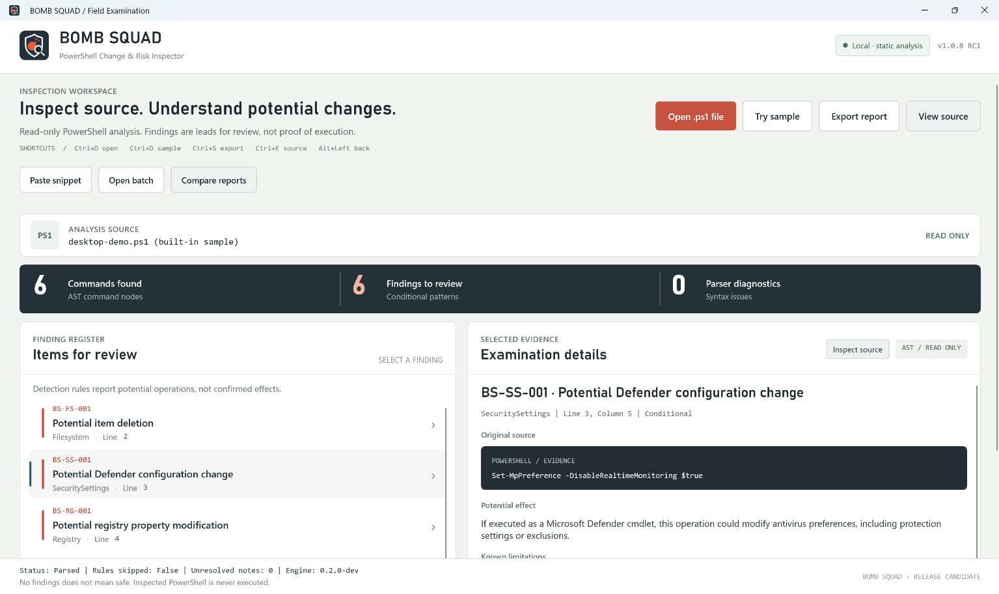
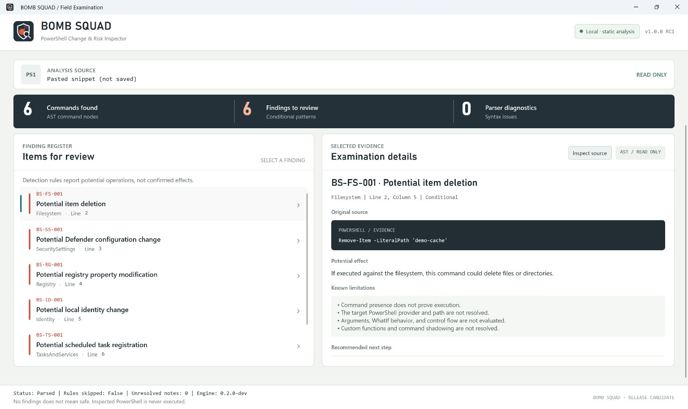
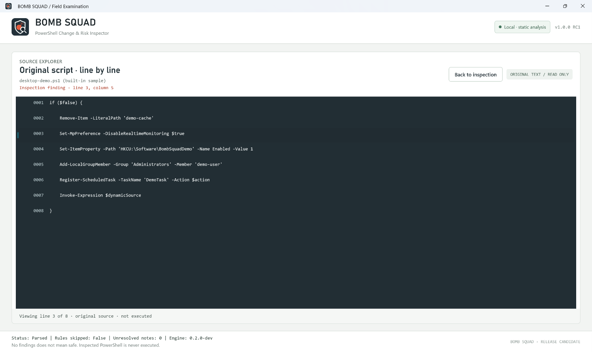
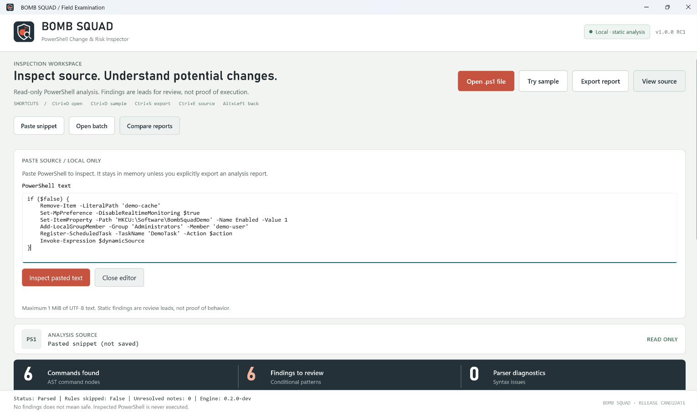

# BOMB SQUAD

**Inspect PowerShell before deciding whether to run it.**

A local, read-only PowerShell change inspector for Windows. **BOMB SQUAD** uses the PowerShell **Abstract Syntax Tree (AST)** to flag selected commands that could modify a system, then shows the exact source, potential effect, and limitations. **It never executes the inspected script.**

[](https://github.com/danielguillaumont/bomb-squad/actions/workflows/windows-ci.yml) [](https://github.com/danielguillaumont/bomb-squad/actions/workflows/windows-distribution.yml)  



## Why it matters

A script can contain commands that delete files, change Defender settings, modify the registry, or schedule tasks. Reading every line manually is slow. Bomb Squad turns **specific, explainable static patterns** into reviewable evidence — not a claim that a command ran or that a script is safe.

## What it does

- **Inspect:** Open `.ps1` files or paste snippets; parse locally without executing input.
- **Explain:** Explore six rule families — filesystem, security settings, registry, local identity, tasks/services, and dynamic execution — with source location and caveats.
- **Investigate:** Jump from a finding to the original source, syntax diagnostics, and recommended review steps.
- **Scale:** Inspect explicitly selected file batches, export JSON, and compare saved batch snapshots for new, persistent, or no-longer-detected matches; incomplete comparisons are identified.
- **Automate:** Use the .NET CLI and optional CI exit-code gates.

| Evidence details | Source explorer |
| --- | --- |
|  |  |

<details>
<summary>See the paste-a-snippet workflow</summary>



</details>

## Try it

**Windows x64:** The current release-candidate package is published as a [GitHub Actions distribution artifact](https://github.com/danielguillaumont/bomb-squad/actions/workflows/windows-distribution.yml) (sign-in may be required). It is an **unsigned ZIP**, not an installer or a published v1.0.0 GitHub Release. Extract the actual distribution ZIP and launch `BombSquad.Desktop.exe` from the extracted application folder. Select **Try sample** to explore the six findings without supplying your own script.

**Build from source** (Windows, .NET 10 SDK and WinUI development prerequisites):

```powershell
git clone https://github.com/danielguillaumont/bomb-squad.git
cd bomb-squad
dotnet test .\BombSquad.slnx -c Release
dotnet run --project .\src\BombSquad.Desktop\BombSquad.Desktop.csproj -c Debug
```

**CLI example** (analyzes the sample as text):

```powershell
dotnet run --project .\src\BombSquad.Cli\BombSquad.Cli.csproj -c Release -- --file .\samples\example.ps1
```

The included sample uses a deliberately non-executing `if ($false)` block to demonstrate detections. See [`samples/example.ps1`](samples/example.ps1) for the input; the inspector still reports potential operations because static matches do not prove runtime execution.

## Built with

**C# · .NET 10 · WinUI 3 · PowerShell AST · xUnit · PowerShell · GitHub Actions**

The solution separates the **core models**, **AST analysis**, **rules**, **CLI**, and **WinUI desktop**. Engineering highlights include **317 passing automated tests**, reproducible Windows x64 packaging, ZIP-entry safety checks, SHA-256 manifests, and verification of the extracted distribution. [Release contract and technical caveats](docs/v10-release-contract.md) · [Design system](docs/desktop-design-system.md).

**Scope:** This is a bounded, static review aid, not an antivirus or malware verdict engine. It does not resolve runtime control flow, every command alias/provider, or arbitrary dynamic behavior. **No findings does not mean safe.**
